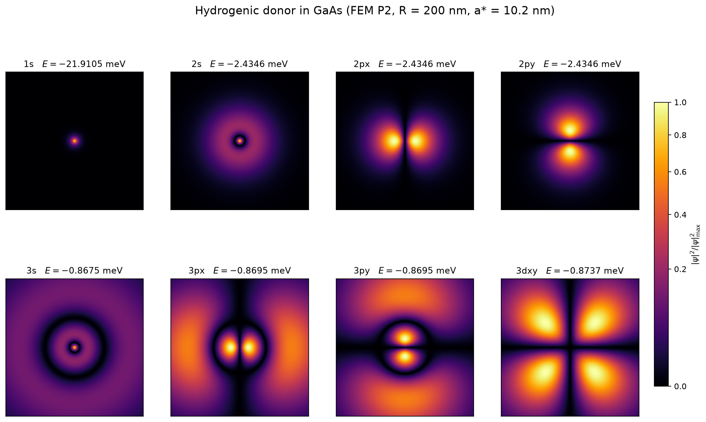
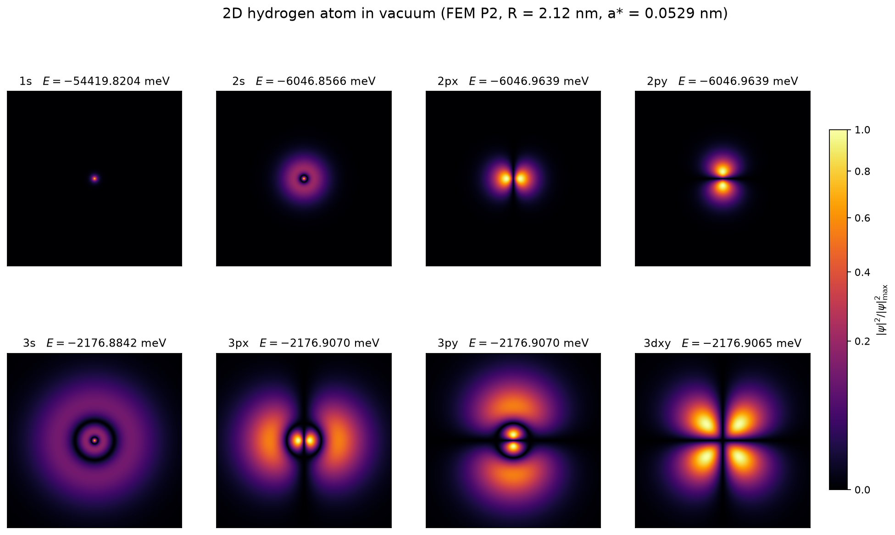
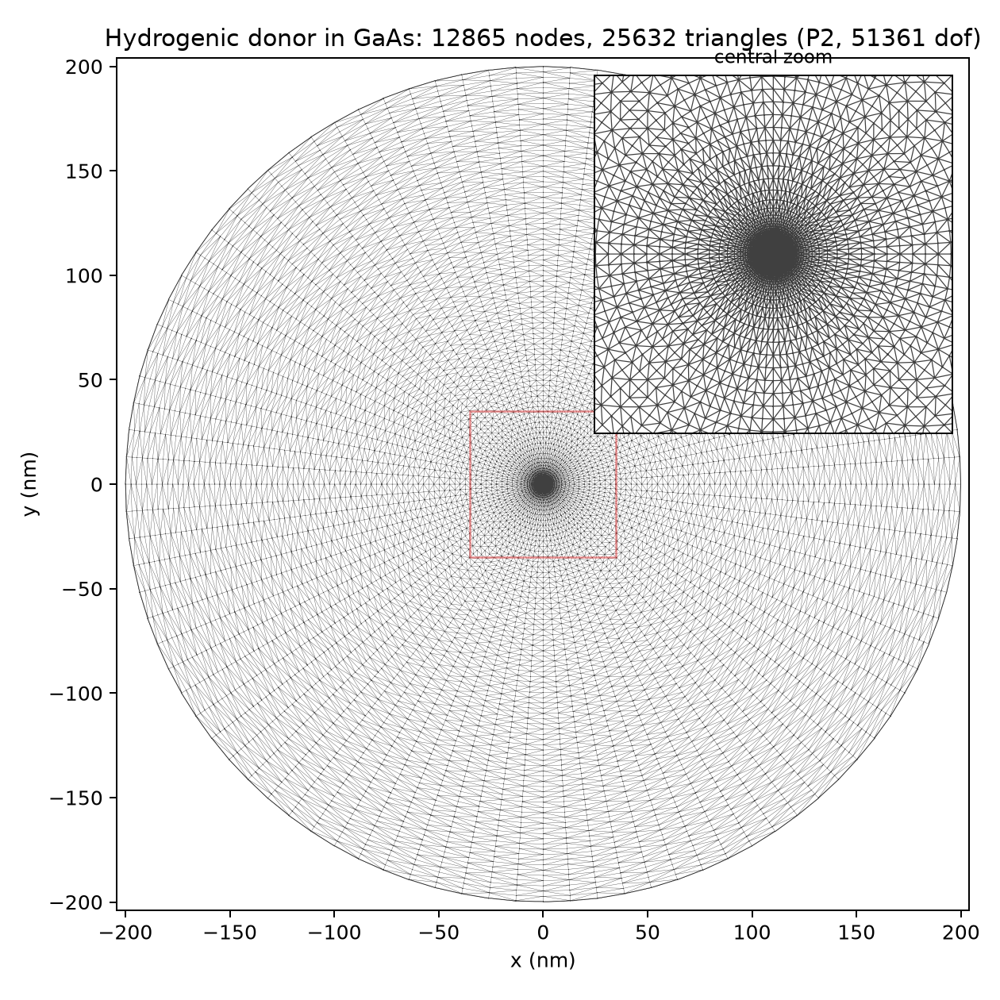
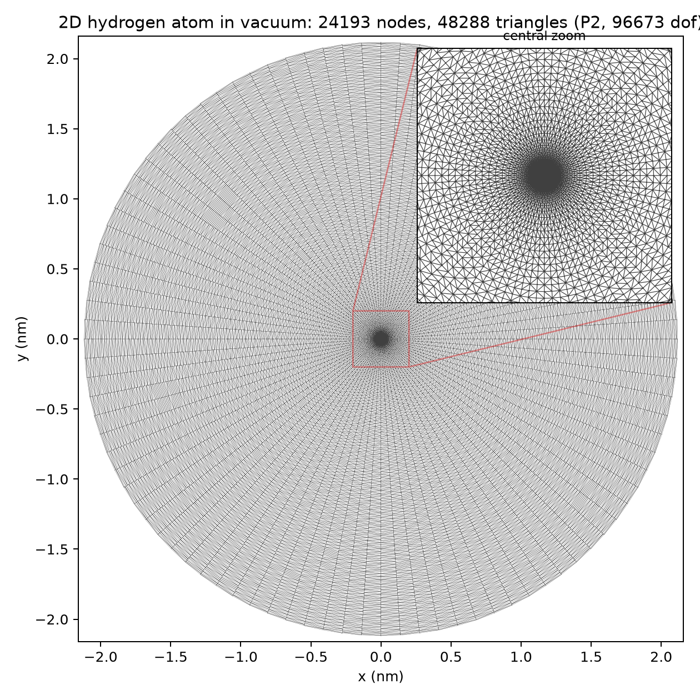

<div align="center">

# 2D hydrogen atom & hydrogenic impurity

### Analytic solution + finite elements from scratch

[](https://www.python.org/)
[](https://numpy.org/)
[](https://www.comsol.com/)
[](LICENSE)
[](figures/LICENSE)
[](https://github.com/danielparra2)

</div>

<p align="center">
  
</p>

<p align="center">
  <sub><b>The eight orbitals of a hydrogenic donor in GaAs</b>, computed with an in-house P2 finite-element
  solver on a Delaunay mesh (<i>R</i> = 200 nm, <i>a</i>* = 10.19 nm). The color is
  |&psi;|&sup2;/|&psi;|&sup2;<sub>max</sub>. These are not analytic plots: they come out of the eigensolver.</sub>
</p>

<p align="center">
  
</p>

<p align="center">
  <sub><b>The same solver, the same equation, a different scale:</b> the 2D hydrogen atom in vacuum
  (<i>a</i>* = 0.0529 nm, domain 2.12 nm). Compare the nodal structure with the GaAs panel above.</sub>
</p>

> [!TIP]
> **What this repository is**
> A compact, reproducible implementation of the 2D Coulomb problem: the **exact analytic solution**
> (thesis appendix B) and a **finite-element solver written from scratch** — Delaunay mesh, quadratic
> Lagrange elements, seven-point quadrature, sparse assembly and a shift-invert eigensolver.
> No external FEM library.

---

## The same equation at two scales

The dimensionless problem is identical. Only the effective Bohr radius `a*`
and the effective Rydberg `Ry*` change:

| | Vacuum | GaAs |
|---|---|---|
| `m*` | `m0` | `0.067 m0` |
| `eps_r` | `1` | `12.9` |
| `a*` | **0.052918 nm** | **10.1886 nm** |
| `Ry*` | **13.606 eV** | **5.4779 meV** |
| Ground state `E0 = -4 Ry*` | **-54.423 eV** | **-21.912 meV** |
| FEM domain | `40 a*` = 2.12 nm | 200 nm |

This is why a hydrogen atom and a donor in a semiconductor share the same
orbitals, only stretched by `a*` and shifted by `Ry*`.

---

## Analytic solution

The Hamiltonian in polar coordinates is

$$
\hat H = -\frac{\hbar^2}{2\mu}
\left(
\frac{\partial^2}{\partial r^2}
+\frac{1}{r}\frac{\partial}{\partial r}
+\frac{1}{r^2}\frac{\partial^2}{\partial \phi^2}
\right)
-\frac{e^2}{4\pi\varepsilon_0 r}.
$$

Separation of variables, `psi(r, phi) = R_nm(r) Phi_m(phi)`, gives

$$
\Phi_m(\phi) = \frac{1}{\sqrt{2\pi}}e^{im\phi},
\qquad m = 0, \pm1, \dots, \pm n,
$$

$$
R_{nm}(r) = N_{nm}\,\rho^{|m|}e^{-\rho/2}
L_{n-|m|}^{2|m|}(\rho),
\qquad
\rho = \frac{2r}{\left(n+\tfrac12\right)a^*},
$$

and the energies

$$
E_n = -\frac{Ry^*}{\left(n+\tfrac12\right)^2},
\qquad n = 0,1,2,\dots
$$

`N_nm` is fixed by `∫ |R_nm|² r dr = 1`. The thesis leaves it implicit; here it
is computed by adaptive quadrature (`src/atomo2d/analitica.py`), so every
radial function is normalized for any `(n, m)`.

| `n` | Vacuum `E_n` (meV) | GaAs `E_n` (meV) |
|---|---|---|
| 0 | -54422.772 | -21.9117 |
| 1 | -6046.975 | -2.4346 |
| 2 | -2176.911 | -0.8765 |
| 3 | -1088.455 | -0.4472 |
| 4 | -653.073 | -0.2705 |
| 5 | -435.382 | -0.1811 |
| 6 | -311.920 | -0.1297 |
| 7 | -234.150 | -0.0974 |

The full derivation — including the original Spanish appendix B text — is in
[`docs/analitica.md`](docs/analitica.md).

---

## Finite elements from scratch

<table>
<tr>
<td width="50%" align="center">
  <br>
  <sub><b>GaAs.</b> Delaunay mesh with geometric refinement towards the donor (<i>R</i> = 200 nm).</sub>
</td>
<td width="50%" align="center">
  <br>
  <sub><b>Vacuum.</b> Same strategy on a 2.12 nm domain (<i>R</i> = 40 <i>a</i>*).</sub>
</td>
</tr>
</table>

- **Mesh:** unstructured Delaunay triangulation of concentric rings with
  `h(r) = min(h_max, alpha r)`; the origin is a node.
- **Elements:** quadratic Lagrange (P2), six shape functions per triangle.
- **Quadrature:** seven-point Dunavant rule of degree 5; special treatment of
  triangles touching the `1/r` singularity.
- **Assembly:** sparse `K`, `M` and angular-momentum matrices.
- **Eigensolver:** SciPy `eigsh` with shift-invert; `K u = E M u`.
- **Angular labels:** diagonalize `L_z` in each degenerate subspace and build
  real `cos(m phi)` / `sin(m phi)` combinations.

The implementation is in [`src/atomo2d/fem.py`](src/atomo2d/fem.py); the
method notes are in [`docs/metodo.md`](docs/metodo.md).

---

## Validation

| Case | Domain | Largest absolute error | Level | Relative to that level |
|---|---|---|---|---|
| GaAs | 200 nm | **0.0090 meV** | 3s | 1.0 % |
| GaAs | 300 nm | **0.0012 meV** | 1s | 5.5 × 10⁻⁵ |
| Vacuum | 40 a* | **2.95 meV** | 1s | 5.4 × 10⁻⁵ |

- **GaAs, R = 200 nm:** the `n = 2` shell (3s, 3p, 3d) is extended enough to feel the Dirichlet
  boundary, so it is shifted by up to 0.009 meV. This is a finite-size effect, not a mesh error.
- **GaAs, R = 300 nm:** the `n = 2` shell agrees to ≤ 0.0001 meV. The largest remaining error is
  0.0012 meV on the 1s level, and it does not change with the domain size: it comes from the
  treatment of the `1/r` singularity at the origin.
- **Vacuum:** the same relative accuracy as the GaAs 1s level. The absolute error is larger only
  because the binding energy is 54.4 eV instead of 21.9 meV.

The thesis reports ≤ 0.008 meV for the COMSOL model on the 200 nm domain; this independent solver
gives 0.009 meV on the same domain.

Full tables are in [`docs/metodo.md`](docs/metodo.md).

---

## Repository layout

```
2d-hydrogen-atom-hydrogenic-impurity/
├── src/atomo2d/
│   ├── analitica.py      energies, radial functions, real orbitals
│   ├── fem.py            Delaunay mesh, P2, assembly, eigensolver
│   └── figuras.py        orbital and mesh figures
├── scripts/validar.py    runs both cases, writes results/ and figures/
├── notebooks/
│   └── atomo_2d_fem.ipynb    step-by-step walkthrough
├── results/
│   ├── resultados.json
│   └── energies.csv
├── figures/              orbital, mesh and comparison figures
├── models/
│   └── AH2D_material_base.mph    COMSOL reference model (GaAs)
├── docs/
│   ├── analitica.md      analytic derivation + original thesis text
│   └── metodo.md         FEM implementation and validation
├── requirements.txt
├── CITATION.cff
└── LICENSE
```

## Run it

```bash
python -m venv .venv && source .venv/bin/activate
pip install -r requirements.txt

# regenerate results and figures (a few minutes on a laptop)
python scripts/validar.py

# step-by-step explanation
jupyter lab notebooks/atomo_2d_fem.ipynb
```

The notebook uses the precomputed results; it does not re-run the FEM.

## COMSOL model

`models/AH2D_material_base.mph` is the COMSOL model used as reference for the
GaAs case. It is pure GaAs (`c_Ga`, `E_Ga`); the AlGaAs potential `V_Al` is
defined but not used in the eigenvalue equation of this validation. The Python
solver does not read the `.mph`; the file is included for provenance.

## Why this matters

This is the validation engine of the quantum dot chain thesis:
[`quantum-dot-chain-impurity`](https://github.com/danielparra2/quantum-dot-chain-impurity).
The same P2 finite-element strategy — multiscale mesh, sparse assembly,
shift-invert eigensolver — is used there to solve a five-dot GaAs/AlGaAs chain
with a donor impurity and an external electric field.

## Citation and license

If you use this material, please cite it via [`CITATION.cff`](CITATION.cff).

- **Code:** MIT — see [`LICENSE`](LICENSE).
- **Original figures:** CC BY 4.0 — see [`figures/LICENSE`](figures/LICENSE).

<div align="center">

**Author:** [Daniel Parra Parra](https://github.com/danielparra2) · Universidad Industrial de Santander (UIS)
· sasukeda25@gmail.com

</div>
